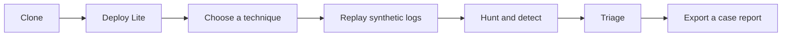

# ThreatHuntX

A free, MIT-licensed threat-hunting lab that teaches 40 offensive techniques through synthetic evidence, detection engineering, and defensive response.

[Quick start](#quick-start) · [40 scenarios](docs/evidence-matrix.md) · [Accessible scenario data](docs/scenario-matrix.json) · [Learning paths](docs/curricula/README.md) · [Static showcase](public-demo/README.md)

The catalog covers eight learning domains. Each lesson links its telemetry and defensive controls to a pinned Enterprise ATT&CK 20.1 mapping and shows the outcomes of a positive, clean, and noisy fixture. The existing ATT&CK screenshot below shows verified fixture coverage. [Evidence matrix](docs/evidence-matrix.md)

## Quick start

Use Git and Docker Engine or Docker Desktop with Compose v2. The command below selects the v2 review branch while the pull requests are open. Run on a Linux checkout or see the Docker Desktop guide for Windows WSL 2 and macOS. [Platform instructions](docs/WINDOWS_AND_MACOS.md)

```bash
git clone --branch community-v2-workspace https://github.com/Aventador-LP700/ThreatHuntX.git
cd ThreatHuntX
docker compose up -d --build --wait
curl -fsS http://127.0.0.1:8080/api/health
```

Open <http://127.0.0.1:8080/> and click **Start Learning**. The MFA Fatigue exercise shows three linked challenge records, an alert and a noisy control. Try changing the threshold in **Detection Studio**, then save a triage decision and export a case report. [First 10 minutes](docs/FIRST_10_MINUTES.md)

Use `./scripts/setup.sh` as the single Bash launcher from a checkout. Check services with `docker compose ps` and diagnostics with `docker compose logs api web`. Use `docker compose down` to stop them and `./scripts/setup.sh reset` while running to clear replay records. [Setup](docs/GETTING_STARTED.md) · [Troubleshooting](docs/TROUBLESHOOTING.md)

## How it works



[](docs/media/lite-boundaries.png)

Vue and Nginx expose the lab on loopback. FastAPI evaluates bundled records and stores replay evidence in SQLite. The browser stores course progress and optional case analysis. The static showcase serves precomputed synthetic records and reports. [Reference architecture](docs/REFERENCE_ARCHITECTURE.md) · [Original architecture illustration](docs/media/architecture.png)

## Learn, tune, and investigate

- Use the Technique Map or follow a role-based pathway. Open the guided lesson, download the source samples and answer the knowledge checks. [All 40 lessons](docs/evidence-matrix.md)
- Compare the published rule against temporary threshold, grouping and window settings in Detection Studio. Browse 40 Sigma specifications, 20 Wazuh candidates, 15 KQL templates and 15 SPL templates. [Portable detections](docs/PORTABLE_DETECTIONS.md)
- Pivot across case, host, actor and source. Save case notes locally and export JSON, spreadsheet-safe CSV or a printable report. [Case report guide](docs/CASE_REPORTS.md)
- Work through 15 testable hunt hypotheses and five worked investigations. [Hunt hypotheses](docs/HUNT_HYPOTHESES.md) · [Case studies](docs/case-studies/README.md) · [Media](docs/media/README.md)

[](docs/media/attack-matrix.webp)

[](docs/media/v2-detection-studio.webp)

## Deployment tracks and validation

| Track | Evidence |
| --- | --- |
| Community Lite on Linux x86-64 | Loopback Compose deployment, fixture comparison, all 40 lesson pages, evidence and report exports. |
| Static showcase | Static build and browser tests on a project subpath. GitHub Pages setup is documented. |
| Optional Wazuh | Native Wazuh 4.14.10 engine check on 138 synthetic records across the 20 event-level candidate rules. Full manager and collector paths are tracked separately. |
| Vendor and sensor examples | Eight native-shaped sample adapters and an offline network baseline. Live sensor and licensed vendor query checks await their environments. |

[Observed verification](reports/validation-summary.md) · [Integration acceptance](docs/INTEGRATION_ACCEPTANCE.md) · [Optional analyst lab](docs/full-lab-setup.md) · [How to deploy the showcase](public-demo/README.md)

Use Lite for safe training on deterministic records. The readiness metrics describe this labeled fixture corpus. Review the [safety scope](docs/SAFETY_AND_SCOPE.md), [privacy practices](docs/PRIVACY.md) and [threat model](docs/threat-model.md) before adding evidence or optional sensors.

## Contribute

Report a reproducible issue, improve a lesson, or submit a reviewed synthetic example. Star the repository to find it again. [Contribution guide](CONTRIBUTING.md) · [Scenario template](scenarios/templates/scenario-template.json) · [Code of conduct](CODE_OF_CONDUCT.md) · [Security disclosures](SECURITY.md)

[Release candidate notes](docs/RELEASE_0_2.md) · [Changelog](CHANGELOG.md) · [Roadmap](ROADMAP.md) · [MIT license](LICENSE) · [Third-party notices](THIRD_PARTY_NOTICES.md)
