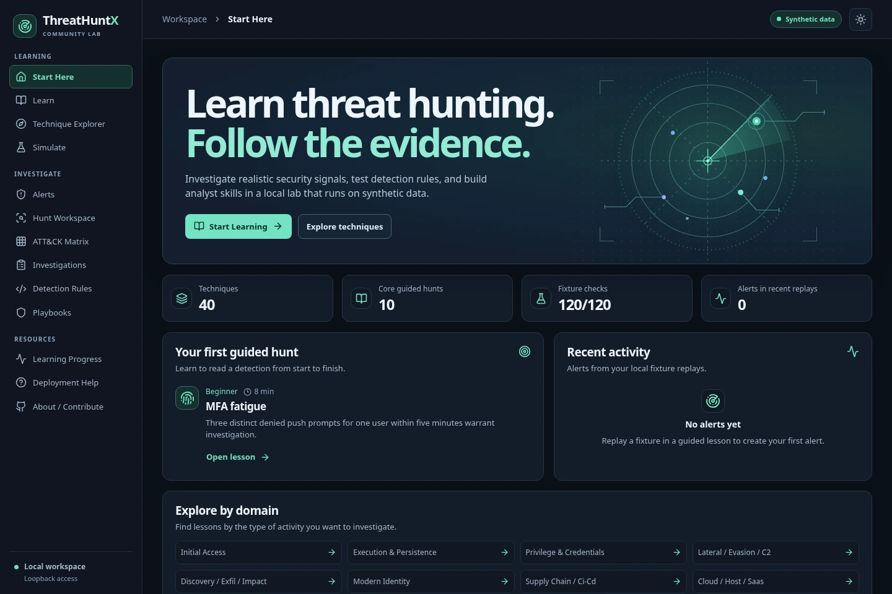
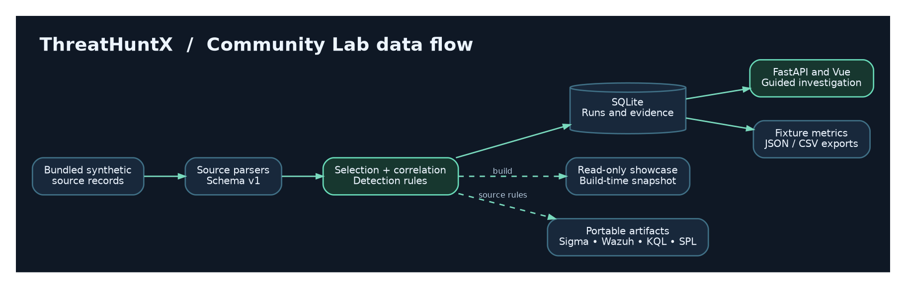

# ThreatHuntX

ThreatHuntX is a free, MIT-licensed threat-hunting education platform. Learn to move from a clean baseline to an evidence-backed response using synthetic security telemetry.



## Quickstart

**New to threat hunting?** Follow the [10-minute MFA investigation](docs/FIRST_10_MINUTES.md) and export your first completed lesson. **Already comfortable in a SOC?** Browse the [40 scenario lessons and detection coverage](docs/evidence-matrix.md) or choose a [role-based curriculum](docs/curricula/README.md).

The Community Lab runs Vue behind Nginx, a FastAPI service, and a project-local SQLite database. The engine parses bundled records before applying source-specific rules. The dashboard links alerts to the exact records that contributed to them. The optional [static showcase](public-demo/README.md) uses precomputed synthetic examples. Vendor sensors and live validation have their own setup scope.



Install Docker with the Compose v2 plugin. Use Docker Desktop with Linux containers and WSL2 on Windows. The reference run is Linux x86-64. See [the validation report](reports/validation-summary.md) for measured resource use and other platform status.

```bash
git clone https://github.com/Aventador-LP700/ThreatHuntX.git
cd ThreatHuntX
./scripts/setup.sh doctor  # Optional Bash preflight
docker compose up -d --build
docker compose ps
curl -fsS http://127.0.0.1:8080/api/health
```

Open <http://127.0.0.1:8080/> when both services are healthy. Select **Start Learning**, open the MFA baseline, and click **Replay safe events** to see one alert. The noisy fixture illustrates why retries and approved enrollment need separate handling. Windows PowerShell users can check health with `Invoke-RestMethod http://127.0.0.1:8080/api/health`.

For one Bash command from a checkout, run `./scripts/setup.sh`. It builds the app, checks health and prints the loopback URL. Run `docker compose down` to stop the services and keep replay history. Use `./scripts/setup.sh reset` on the running lab to clear investigation history and restore the bundled baselines. [Setup and troubleshooting](docs/GETTING_STARTED.md) · [Upgrade and reset](docs/TROUBLESHOOTING.md)

## Coverage

| Surface | Scope |
| --- | --- |
| Community Lab | 40 interactive scenarios. API integration checks cover every clean baseline, positive replay, matched evidence and noisy replay. 10 core lessons have dedicated browser tests. |
| ATT&CK | Enterprise 20.1. Each mapping includes an official technique reference and direct or related status. |
| Sigma | 40 original specifications with offline pySigma and fixture-selection checks. |
| Wazuh | 20 candidate rules and one custom JSON decoder, with static XML and fixture checks. |
| KQL and SPL | 15 templates each, with documented custom projections and offline checks. Vendor verification is pending. |
| Static showcase | 40 lessons, read-only samples, local learning progress and rule views. |

[All 40 techniques and backend statuses](docs/evidence-matrix.md) · [Field mapping and portability](docs/PORTABLE_DETECTIONS.md) · [Observed validation](reports/validation-summary.md)

## Investigations and learning material

- Inspect [the MFA investigation](docs/case-studies/02-mfa-fatigue.md) or one of the [five case studies](docs/case-studies/README.md). Follow matched record IDs in [sample exports](examples/README.md).
- Try a hypothesis in the [hunt workspace](docs/HUNT_HYPOTHESES.md) and apply one of the [eight response playbooks](docs/analyst-playbooks/README.md).
- Compare [Sigma](detections/sigma), [Wazuh XML](detections/wazuh), [KQL](detections/kql) and [SPL](detections/spl), and [learn to tune a detection](docs/HOW_TO_WRITE_A_DETECTION.md).
- Read the [test definitions](docs/TESTING_AND_VALIDATION.md) before interpreting matrix metrics. Precision and recall describe the bundled positive and control batches.


## Deploy, contribute, and get help

- Review [architecture](docs/REFERENCE_ARCHITECTURE.md), [threat model](docs/threat-model.md), [privacy](docs/PRIVACY.md) and [safe lab scope](docs/SAFETY_AND_SCOPE.md).
- See [optional analyst integrations](docs/full-lab-setup.md), [FAQ](docs/FAQ.md), [troubleshooting](docs/TROUBLESHOOTING.md) and the [roadmap](ROADMAP.md).
- Follow the [contribution guide](CONTRIBUTING.md) and [code of conduct](CODE_OF_CONDUCT.md). For a private security disclosure, use the [security policy](SECURITY.md).
- Read the [release notes](docs/RELEASE_NOTES.md), [changelog](CHANGELOG.md) and [maintainer hand-off](docs/MAINTAINER_HANDOFF.md).

Maintainer [Aventador-LP700](https://github.com/Aventador-LP700). The source, original media and original examples use the [MIT license](LICENSE). See [third-party notices](THIRD_PARTY_NOTICES.md) for MITRE ATT&CK and frontend licenses.
