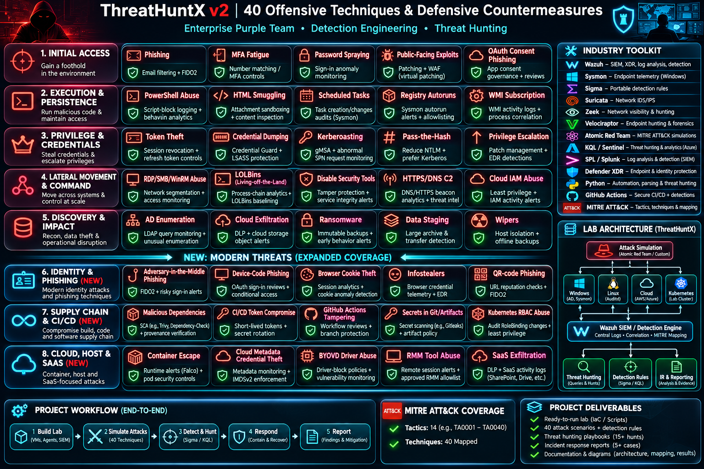
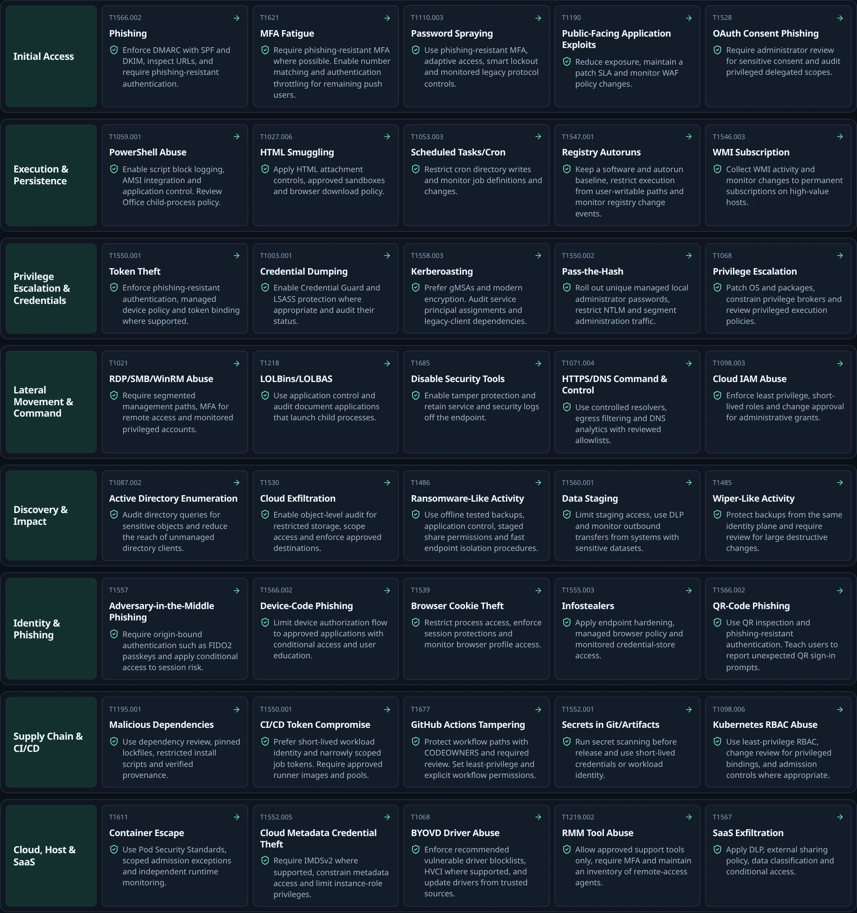
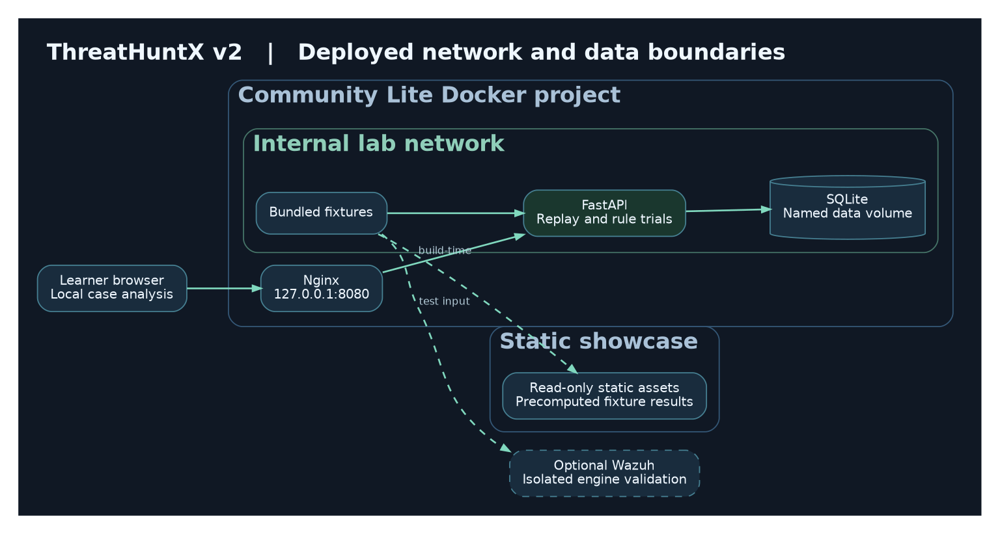
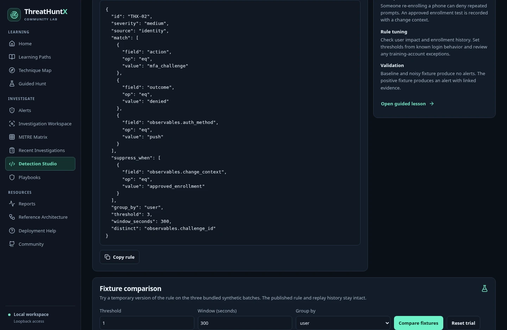

# ThreatHuntX v2 — Threat-Hunting & Detection Lab

**Replay an incident. Test the detection. Document the response.**

[](docs/diagrams/png/threathuntx-v2-40-threat-map.png)

[Original PNG](docs/diagrams/png/threathuntx-v2-40-threat-map.png) · [SVG](docs/diagrams/svg/threathuntx-v2-40-threat-map.svg) · [PDF](docs/diagrams/pdf/threathuntx-v2-40-threat-map.pdf) · [Scenario catalog (JSON)](docs/scenario-matrix.json) · [Deploy locally](#five-minute-start-with-docker)

The infographic shows the project framework, including optional infrastructure. The Community Lab replays synthetic telemetry. Its 40 scenarios map to 36 distinct ATT&CK IDs across 13 tactics. [Verified mappings](docs/evidence-matrix.md) · [Integration status](docs/INTEGRATION_ACCEPTANCE.md)

[](https://github.com/Aventador-LP700/ThreatHuntX/actions/workflows/ci.yml)
[](LICENSE)

ThreatHuntX is a free, open-source lab for SOC analysts, detection engineers, and purple-team learners. Its 40 guided scenarios show what offensive techniques look like in security logs, how to recognize them, and which controls reduce the risk. Replay bundled synthetic telemetry, compare a detection against clean and noisy controls, investigate the matching records, and write up the case.

[Quick start](#five-minute-start-with-docker) · [Scenario lab](#scenario-lab) · [Terminal exercises](#run-and-verify-from-the-terminal) · [Architecture](#lab-architecture) · [Diagram and image downloads](docs/diagrams/README.md) · [Validation](#deployment-and-validation) · [Contribute](#contribute)

## Five-minute start with Docker

Use Git and Docker Engine or Docker Desktop with Compose v2. [Windows and macOS notes](docs/WINDOWS_AND_MACOS.md)

```bash
git clone https://github.com/Aventador-LP700/ThreatHuntX.git
cd ThreatHuntX
bash ./scripts/setup.sh
curl -fsS http://127.0.0.1:8080/api/health
```

The Bash launcher checks Docker and starts the two Compose services. The equivalent Compose command is `docker compose up -d --build --wait`. The first build downloads pinned images and dependencies. A healthy lab returns `{"status":"ok","schema_version":1,"synthetic_only":true}`.

Open <http://127.0.0.1:8080/> and choose **Start Learning** to work through MFA Fatigue. Use **Browse scenario lab** to go directly to the eight-domain map. [Setup and troubleshooting](docs/GETTING_STARTED.md) · [First 10 minutes](docs/FIRST_10_MINUTES.md)

## Scenario lab

Every exercise includes an attacker objective, a clean baseline, a positive replay, a noisy control, a local detection, a response and prevention guide, and a knowledge check. The Technique Map pairs each scenario with its countermeasure and opens the corresponding lesson. Search by technique, defensive control, or ATT&CK ID.

[](docs/diagrams/png/v2-technique-map.png)

Download the full-size lab map as [SVG](docs/diagrams/svg/v2-technique-map.svg), [PNG](docs/diagrams/png/v2-technique-map.png), or [PDF](docs/diagrams/pdf/v2-technique-map.pdf).

[All 40 walkthroughs and fixture results](docs/evidence-matrix.md) · [Machine-readable catalog](docs/scenario-matrix.json) · [Role-based learning paths](docs/curricula/README.md)

| Domain | Scenarios | Example investigation |
| --- | --- | --- |
| Initial Access | 01–05 | Separate repeated denied push prompts from approved enrollment in [MFA Fatigue](docs/learn/02.md). |
| Execution & Persistence | 06–10 | Inspect the origin and target of a Run or RunOnce value in [Registry Autoruns](docs/learn/09.md). |
| Privilege Escalation & Credentials | 11–15 | Review process access to LSASS and the clean control in [Credential Dumping](docs/learn/12.md). |
| Lateral Movement & Command | 16–20 | Pivot from rare-domain observations to the associated host in [HTTPS/DNS Command & Control](docs/learn/19.md). |
| Discovery & Impact | 21–25 | Compare restricted-object access patterns in [Cloud Exfiltration](docs/learn/22.md). |
| Identity & Phishing | 26–30 | Review session risk and origin-bound authentication in [Adversary-in-the-Middle Phishing](docs/learn/26.md). |
| Supply Chain & CI/CD | 31–35 | Trace an elevated permission grant in [Kubernetes RBAC Abuse](docs/learn/35.md). |
| Cloud, Host & SaaS | 36–40 | Determine which share and external recipients to investigate in [SaaS Exfiltration](docs/learn/40.md). |

### Example exercise · MFA Fatigue

1. In **Clean baseline**, expand a normal sign-in record and examine its evidence fields.
2. In **Replay & evidence**, replay the positive batch. Follow the alert to the timeline and identify its three distinct denied challenges. Replay the noisy batch and check that it produces zero alerts.
3. In **Detection Studio**, change the threshold from 3 to 4. The positive fixture should become a miss. Restore 3 and confirm the alert returns while the two controls stay quiet.
4. Record your triage decision, response and supporting evidence in the investigation. Export the case as JSON, CSV, or a printable report.

[Guided walkthrough](docs/FIRST_10_MINUTES.md) · [Case report guide](docs/CASE_REPORTS.md) · [MFA replay video](docs/media/mfa-replay.mp4)

## Run and verify from the terminal

Start the Compose lab first, then run all 40 exercises or select one scenario. Reports include source fixture paths, expected and observed alert decisions, matched record IDs, response and prevention.

```bash
mkdir -p build
./scripts/setup.sh lab all > build/scenario-assessment.md
./scripts/setup.sh lab 02 --format json > build/mfa-assessment.json
```

The all-scenario assessment should report `Published rules passed 120 of 120 fixture checks.` A mismatch returns exit status 1 and still writes the evidence. The runner evaluates files in memory.

To see a detection regression, run `./scripts/setup.sh lab 02 --threshold 4`. It exits 1 when the positive batch misses. Rerun with `--threshold 3` to confirm all three checks pass. Each report includes the published rule beside the temporary trial.

### Terminal-only start with Python

With an existing checkout, Python 3.12 and [uv](https://docs.astral.sh/uv/), run the same assessment directly.

```bash
PYTHONPATH=backend uv run --locked python -m app.cli lab 02
```

## Lab architecture

[](docs/media/lite-boundaries.png)

Download the architecture diagrams as SVG, PNG, and PDF. [Diagram and image downloads](docs/diagrams/README.md#diagrams)

Vue and Nginx serve the local workspace over loopback. FastAPI evaluates bundled telemetry on the internal Compose network and stores replay evidence in SQLite. The browser stores learning progress and optional case analysis. The static showcase serves precomputed synthetic examples and supports browser-local analysis. [Reference architecture](docs/REFERENCE_ARCHITECTURE.md) · [Optional analyst lab topology and setup](docs/full-lab-setup.md)

| Workflow | What you can use |
| --- | --- |
| Investigate and respond | Case, host, actor and source pivots, 15 hunt hypotheses, five worked cases, and evidence exports. [Hunts](docs/HUNT_HYPOTHESES.md) · [Case studies](docs/case-studies/README.md) |
| Engineer a detection | Compare temporary threshold, grouping and window settings. Inspect 40 Sigma specifications, 20 Wazuh candidates, 15 KQL templates and 15 SPL templates. [Portable detections](docs/PORTABLE_DETECTIONS.md) |
| Work with source records | Read vendor-shaped sample adapters for endpoint, network, cloud, identity and audit logs. [Vendor samples](docs/VENDOR_SAMPLES.md) |
| Extend the lab | Set up optional Wazuh and collectors on separate machines, with per-tool requirements and verification steps. [Optional integrations](docs/full-lab-setup.md) |

[](docs/media/v2-detection-studio.webp)

## Deployment and validation

| Track | Recorded coverage |
| --- | --- |
| Community Lite on Linux x86-64 | Compose health, all 40 lesson routes, synthetic fixture comparison, evidence export and report workflows. |
| Terminal assessment | Runs 40 scenarios with 120 labeled batches. Includes Markdown and JSON reports and temporary per-scenario threshold trials. |
| Static showcase | Local HTTP and browser coverage under a project subpath. GitHub Pages setup is documented. |
| Optional Wazuh 4.14.10 | Native engine check on 138 synthetic records for the 20 event-level candidates. Manager and collector deployment are separate acceptance checks. |
| External platforms and sensors | Offline samples and template review. Live collectors and licensed query endpoints require separate validation. |

Fixture results describe the bundled teaching corpus. [Recorded verification](reports/validation-summary.md) · [Integration acceptance](docs/INTEGRATION_ACCEPTANCE.md) · [Static showcase setup](public-demo/README.md) · [Safety and scope](docs/SAFETY_AND_SCOPE.md) · [Privacy](docs/PRIVACY.md)

Use `./scripts/setup.sh health` to check service health, `docker compose logs api web` for diagnostics, and `./scripts/setup.sh down` to stop the lab. While the lab is running, `./scripts/setup.sh reset` restores the clean baselines and clears replay records. [Troubleshooting](docs/TROUBLESHOOTING.md)

## Repository map

| Path | Contents |
| --- | --- |
| [scenarios/](scenarios/) | Scenario manifests, normalized fixtures, schemas and ATT&CK data |
| [docs/learn/](docs/learn/) | The 40 guided walkthroughs |
| [detections/](detections/) | Portable defensive rules and query templates |
| [backend/](backend/) and [frontend/](frontend/) | Local detector, assessment runner, API and learning workspace |
| [integrations/](integrations/) and [infra/](infra/) | Vendor sample logs and lab deployment assets |
| [reports/](reports/) | Recorded validation and release evidence |

## Contribute

Reproduce a bug, improve a lesson, or submit a reviewed synthetic example. [Contribution guide](CONTRIBUTING.md) · [Scenario template](scenarios/templates/scenario-template.json) · [Code of conduct](CODE_OF_CONDUCT.md) · [Security disclosures](SECURITY.md)

[Release candidate notes](docs/RELEASE_0_2.md) · [Changelog](CHANGELOG.md) · [Roadmap](ROADMAP.md) · [MIT license](LICENSE) · [Third-party notices](THIRD_PARTY_NOTICES.md)
