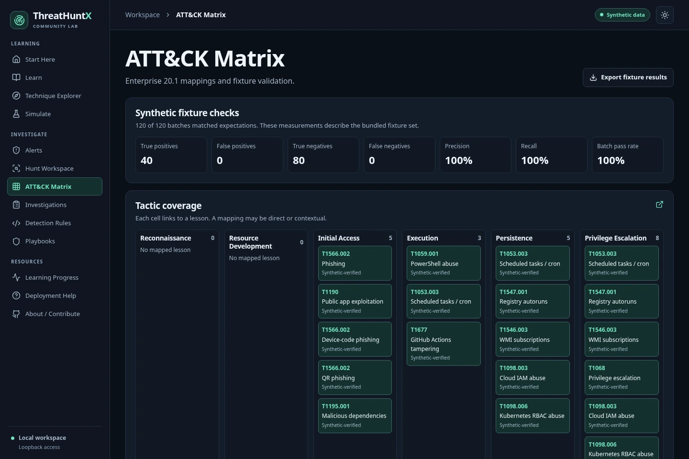
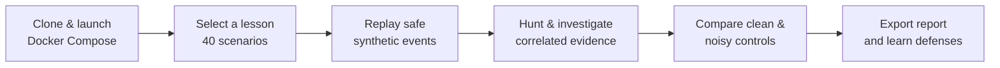
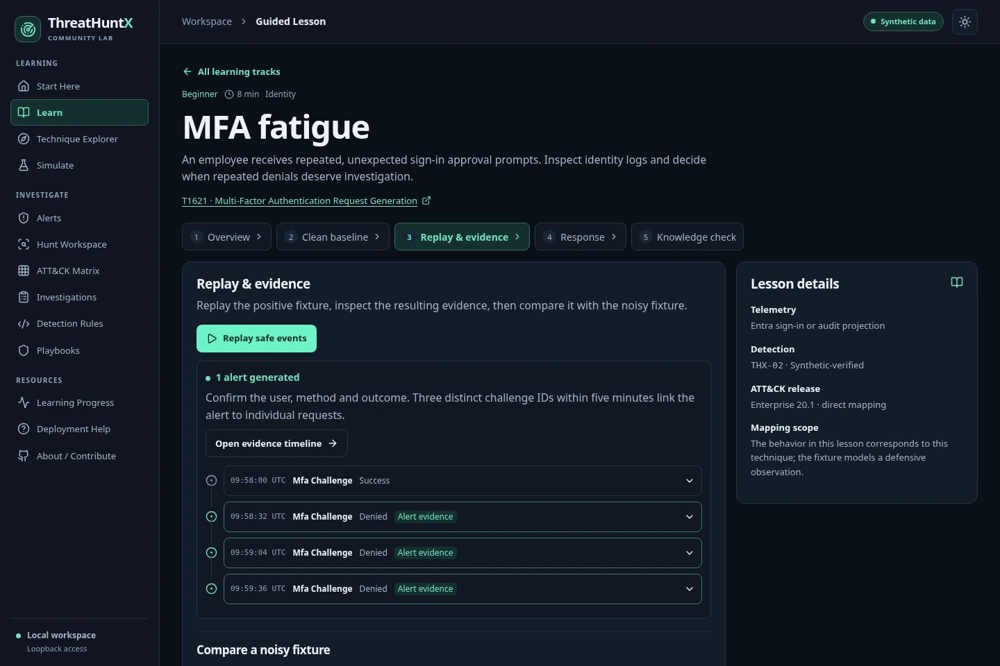

# ThreatHuntX

**40 modern threat scenarios · Offensive behavior → Detection → Defensive response**

ThreatHuntX is a **free, MIT-licensed threat-hunting education lab** for students, SOC analysts, penetration testers, purple teamers, and detection engineers. Explore safe, **synthetic** security telemetry; investigate linked evidence; learn to distinguish attacks from benign activity; and export your findings.

> **Safety and scope:** The default lab **replays packaged synthetic records only**. It does not execute attacks, collect live endpoint data, or include a production SIEM. Wazuh, Windows Sysmon, and other real-sensor integrations are optional and documented separately. [Read the validation boundaries](docs/TESTING_AND_VALIDATION.md).

## 1. See the 40-technique offensive × defensive map

[](docs/media/attack-matrix.webp)

**[View the full-size threat map](docs/media/attack-matrix.webp)** · [Explore every lesson and its validation status](docs/evidence-matrix.md) · [Choose your learning track](docs/curricula/README.md)

## 2. Understand the lab before installing

[](docs/media/architecture.png)

**[Open the architecture diagram](docs/media/architecture.png)** · [Detailed reference architecture](docs/REFERENCE_ARCHITECTURE.md)

### Follow the learner's journey



## 3. Deploy the Community Lab

**Prerequisites:** Git and Docker Engine or Docker Desktop with **Docker Compose v2**. The release candidate was tested on Linux x86-64; Windows/macOS smoke tests remain pending. See [supported environments and resource measurements](reports/validation-summary.md).

```bash
git clone https://github.com/Aventador-LP700/ThreatHuntX.git
cd ThreatHuntX
docker compose up -d --build
```

Once both services are healthy, open **http://127.0.0.1:8080/** and click **Start Learning**.

```bash
docker compose ps
curl -fsS http://127.0.0.1:8080/api/health
```

For a one-command Bash launcher **after cloning**, run `./scripts/setup.sh`. To shut down, run `docker compose down` (preserves local investigation history). Use `./scripts/setup.sh reset` to clear local fixture runs while the lab is running.

**Start with:** [Your first 10-minute MFA investigation](docs/FIRST_10_MINUTES.md) · [Step-by-step setup](docs/GETTING_STARTED.md) · [Troubleshooting](docs/TROUBLESHOOTING.md)

[](docs/media/intro.webp)

**Already familiar with SIEM investigations?** Open the [hunt workspace guide](docs/HUNT_HYPOTHESES.md), [detection-rule documentation](docs/PORTABLE_DETECTIONS.md), and [response playbooks](docs/analyst-playbooks/README.md). A read-only [static showcase](public-demo/README.md) can also be hosted without exposing the writable local lab.

## Coverage

| Surface | Scope |
| --- | --- |
| Community Lab | 40 interactive scenarios. API integration checks cover every clean baseline, positive replay, matched evidence and noisy replay. 10 core lessons have dedicated browser tests. |
| ATT&CK | Enterprise 20.1. Each mapping includes an official technique reference and direct or related status. |
| Sigma | 40 original specifications with offline pySigma and fixture-selection checks. |
| Wazuh | 20 candidate rules and one custom JSON decoder, with static XML and fixture checks. |
| KQL and SPL | 15 templates each, with documented custom projections and offline checks. Vendor verification is pending. |
| Static showcase | 40 lessons, read-only samples, local learning progress and rule views. |

[All 40 techniques and backend statuses](docs/evidence-matrix.md) · [Field mapping and portability](docs/PORTABLE_DETECTIONS.md) · [Observed validation](reports/validation-summary.md)

## Investigations and learning material

- Inspect [the MFA investigation](docs/case-studies/02-mfa-fatigue.md) or one of the [five case studies](docs/case-studies/README.md). Follow matched record IDs in [sample exports](examples/README.md).
- Try a hypothesis in the [hunt workspace](docs/HUNT_HYPOTHESES.md) and apply one of the [eight response playbooks](docs/analyst-playbooks/README.md).
- Compare [Sigma](detections/sigma), [Wazuh XML](detections/wazuh), [KQL](detections/kql) and [SPL](detections/spl), and [learn to tune a detection](docs/HOW_TO_WRITE_A_DETECTION.md).
- Read the [test definitions](docs/TESTING_AND_VALIDATION.md) before interpreting matrix metrics. Precision and recall describe the bundled positive and control batches.



## Deploy, contribute, and get help

- Review [architecture](docs/REFERENCE_ARCHITECTURE.md), [threat model](docs/threat-model.md), [privacy](docs/PRIVACY.md) and [safe lab scope](docs/SAFETY_AND_SCOPE.md).
- See [optional analyst integrations](docs/full-lab-setup.md), [FAQ](docs/FAQ.md), [troubleshooting](docs/TROUBLESHOOTING.md) and the [roadmap](ROADMAP.md).
- Follow the [contribution guide](CONTRIBUTING.md) and [code of conduct](CODE_OF_CONDUCT.md). For a private security disclosure, use the [security policy](SECURITY.md).
- Read the [release notes](docs/RELEASE_NOTES.md), [changelog](CHANGELOG.md) and [maintainer hand-off](docs/MAINTAINER_HANDOFF.md).

Maintainer [Aventador-LP700](https://github.com/Aventador-LP700). The source, original media and original examples use the [MIT license](LICENSE). See [third-party notices](THIRD_PARTY_NOTICES.md) for MITRE ATT&CK and frontend licenses.
