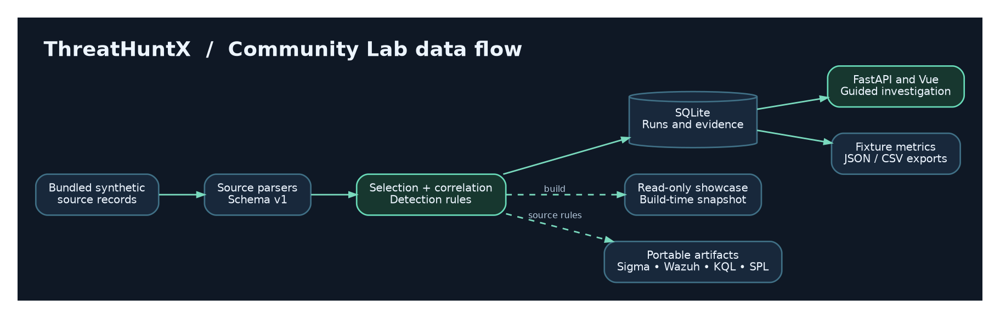
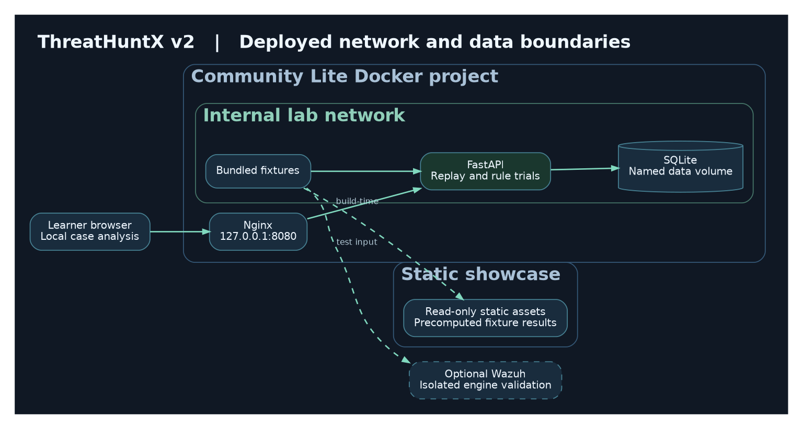
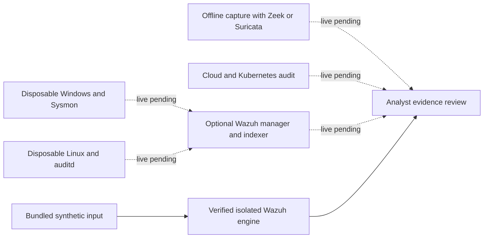

# Reference architecture

ThreatHuntX has three independent distribution options. The static showcase serves a built snapshot. The default Community Lab evaluates packaged fixtures locally. The optional analyst lab connects sensors and SIEMs in a disposable environment under separate management.

[Editable Mermaid source](architecture.mmd) · [Normalized event schema](../scenarios/schema/event-v1.json) · [Threat model](threat-model.md)

## Community Lab

Nginx serves Vue and forwards `/api/` to FastAPI on a private Docker network. Only the web service publishes a host port, bound to `127.0.0.1`. Processes run as non-root with read-only container filesystems. SQLite uses a named volume and WAL mode. Replay is submitted as a scenario ID and fixture variant. The API loads immutable bundled data, applies source-specific normalization, checks a bounded correlation, and commits the replay batch and linked alerts together.

For each batch, the engine sorts UTC records, deduplicates record IDs inside each source, applies event predicates, removes matches for explicit suppressions and groups evidence on a normalized field. Each qualifying group yields its earliest complete evidence window. A next replay is a distinct analyst exercise. Batch labels remain available as ground truth for the evaluation report.

The supplied CSV and technique maps informed the eight learning domains and the layout from behavior to evidence and response. The application architecture and diagrams here are original. MITRE technique metadata comes from the recorded STIX release.

## Static showcase

The build evaluates the same packaged records with the local engine and produces a deterministic JSON snapshot. The public site uses relative asset paths and hash route navigation. A viewer can inspect sample alerts, read the rule library and take quizzes. Browser memory holds opened samples, and browser storage holds completion and theme choices.

## Optional analyst lab

The analysts’ Wazuh examples share the normalized projection. Wazuh rules match event candidates. The local engine’s sliding distinct-value correlations have their own semantics. Vendor-native data requires a separately designed field map, ingestion, timing and approval context. Run advanced components independently. [Optional setup](full-lab-setup.md)

## v2 network boundaries and case data

The lab's internal network carries API traffic between Nginx and FastAPI. Fixture comparisons are calculated from allowlisted, packaged data and return temporary results. Case analysis is kept on the browser origin. Nginx bounds request sizes, Uvicorn limits concurrent work, and Docker rotates logs. The SQLite volume retains evidence until reset or explicit volume removal.

The Pages build hosts static resources. Its fixture comparison reports come from the same engine that powers the local workspace. Browsers may download case reports and keep local notes from those prerecorded examples. [Editable source](lite-boundaries.mmd) · [Case report format](CASE_REPORTS.md) · [Static showcase](../public-demo/README.md)

## Optional analyst topology

Optional components run independently from Lite. [Advanced integration acceptance](INTEGRATION_ACCEPTANCE.md)
